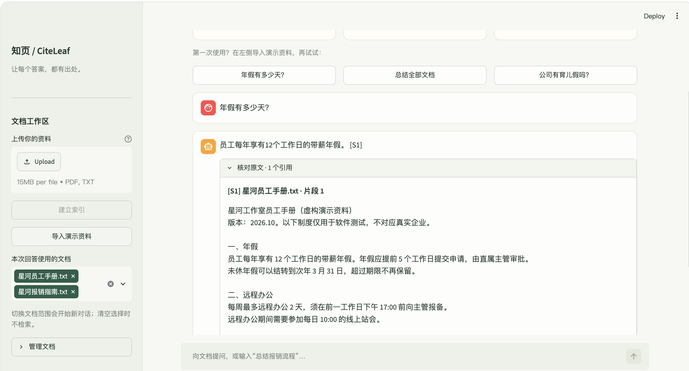
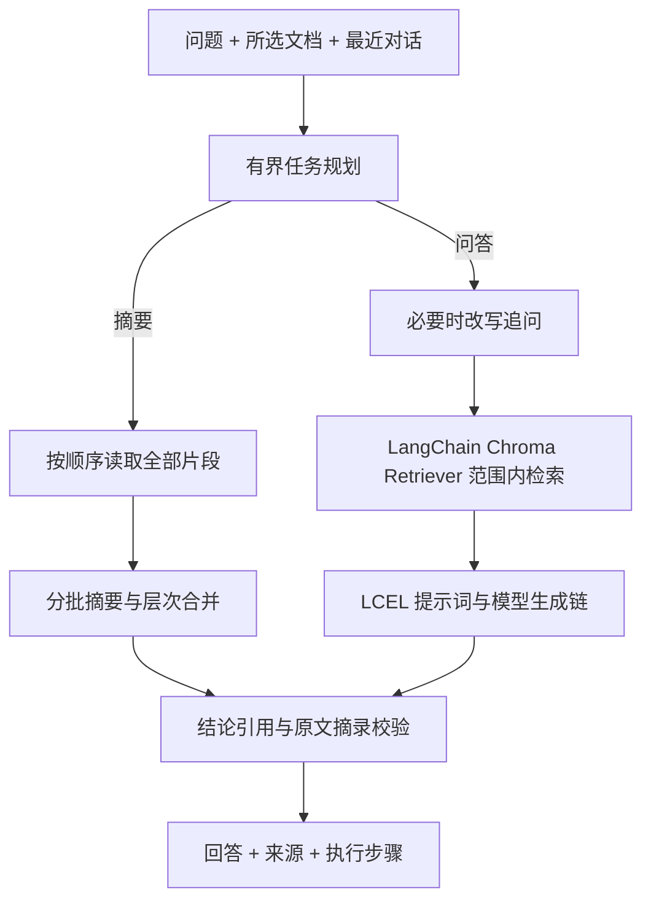

# 知页 CiteLeaf

**把资料，变成有据可查的答案。**

[GitHub 仓库](https://github.com/jiapeng-lab/CiteLeaf) · [验证记录](docs/VALIDATION.md) · [真实模型验收](docs/evaluation.json)

一个面向中文 PDF / TXT 的文档问答 Agent：上传资料，在所选文档内提问、继续追问，或生成全文及指定主题摘要。每条结论携带引用和经过逐字校验的原文摘录，文档没有依据时明确说明。

**技术栈：Python + LangChain + RAG**，搭配 Chroma 向量库、BGE 中文 Embedding、DeepSeek 和 Streamlit。



“Cite”表示引用，“Leaf”表示书页。项目聚焦文档证据，采用 6 个业务模块的单体架构，便于理解、复现与扩展。

## 快速开始

需要 Python 3.12 和 [uv](https://docs.astral.sh/uv/getting-started/installation/)。首次安装依赖和向量模型需要网络与足够磁盘空间，无需 GPU。

锁文件使用清华 PyPI 公共镜像。若镜像在你的网络不可达，可运行 `uv sync --default-index https://pypi.org/simple --group dev` 改用 PyPI；该操作会更新锁文件的来源配置。

Linux / Windows 的 PyTorch 使用官方 CPU 源，避免为本地演示和 CI 下载 CUDA 依赖；macOS 使用标准 wheel。推荐通过 uv 安装以应用这些来源规则。

```bash
uv sync --locked --group dev --python 3.12
cp .env.example .env
# 编辑 .env，填写 LLM_API_KEY；也支持已有的 DEEPSEEK_API_KEY 环境变量。
uv run streamlit run app.py --server.address 127.0.0.1
```

浏览器打开 <http://127.0.0.1:8501>。Windows 可使用 PowerShell 的 `Copy-Item .env.example .env`。

```dotenv
LLM_API_KEY=your_key_here
LLM_BASE_URL=https://api.deepseek.com
LLM_MODEL=deepseek-flash
EMBEDDING_MODEL=BAAI/bge-small-zh-v1.5
```

默认模型名以本次实际接口可用性为准，也可替换成服务商当前支持 JSON 输出的模型。其他兼容接口需同时修改 URL、模型和密钥，并重新运行验收；不承诺所有兼容服务行为完全相同。

向量模型默认从 Hugging Face 下载。网络受限时，先从 [BAAI 官方模型页面](https://huggingface.co/BAAI/bge-small-zh-v1.5) 合法下载完整模型，在 `.env` 中设置 `EMBEDDING_MODEL_PATH=/本地模型目录`。本地模型必须与 `EMBEDDING_MODEL` 指向同一模型；更换模型时同步更新模型标识，避免混用向量。模型权重不随仓库提交。

不使用 uv 时，也可创建 Python 3.12 虚拟环境，运行 `python -m pip install -e .`；该方式不使用 `uv.lock` 的精确解析结果。

## 两分钟演示

1. 点击左侧“导入演示资料”，导入两份自行编写的虚构制度。
2. 选择《星河员工手册》，问“年假有多少天？”：应回答 **12 个工作日**，展开引用核对原文。
3. 追问“需要提前多久申请？”：应结合上文回答 **5 个工作日**。
4. 问“公司有育儿假吗？”：文档没有提供依据，应拒绝推测。
5. 同时选中两份资料，问“年假申请和报销申请的提交时限分别是什么？”：分别为 **5 个工作日**和费用发生后 **20 个自然日**。
6. 输入“总结全部文档”，或切换“文档摘要”后输入“只总结报销审批流程和付款时限”。
7. 展开“查看执行步骤”，观察检索、全文读取或缓存路径；下载本轮对话及引用 JSON。

切换文档范围自动开始新对话，避免上一范围的指代污染。清空选择表示不使用文档，而不是隐式检索整个库。引用编号只在当前回答内有效；PDF 页码为物理页码，TXT 显示片段序号。

## Agent 目标与设计

**目标**：在用户选定的文档范围内完成问答与摘要，使结论可以回到原文；证据不足时保留不确定性。



- **规划**：显式模式优先，自动模式用有限规则识别摘要请求，决定调用检索工具或全文读取工具。它是有界任务型 Agent，不宣称具备开放式自主规划或 Function Calling。
- **工具**：`Knowledge.search` 调用 LangChain Chroma Retriever 检索选中文档；`Knowledge.read` 顺序读取选中文档；解析、入库和删除是界面可调用的数据能力。
- **记忆**：保留最近 6 条消息，每条最多 800 字符，仅用于追问理解；历史不作为事实证据。当前问题独立保留，最多 3000 字。
- **回答**：模型返回 `supported` 和逐条 `claims`，每条结论必须携带证据编号与至少 6 个字符的连续原文摘录。
- **校验**：编号必须存在，摘录移除空白后必须是对应原文的子串；任一结论失败则停止展示生成答案。
- **摘要**：每批最多 5000 字符，读取整个所选文档，逐批生成后层次合并；指定主题在每一批中判断是否存在。避免用 top-k 检索替代全文摘要。

**校验边界**：摘录存在不等于结论必然被原文支持。语义支持、遗漏和指令注入仍需人工抽查及更大规模评估。

## 技术选择与取舍

| 组件 | 选择 | 理由 |
|---|---|---|
| 界面 | Streamlit | 上传、聊天、引用与下载集中在一个入口 |
| 框架 | LangChain 模块化集成包 | 使用统一 Document、Embeddings、Retriever 和 Runnable 接口 |
| 向量模型 | HuggingFaceEmbeddings + BGE small 中文 | CPU 可运行，Embedding 在本地完成 |
| 向量库 | langchain-chroma + Chroma 持久化 | 保存文本、向量与来源元数据，Retriever 按文档范围过滤 |
| 文档处理 | pypdf + UTF-8 TXT | 覆盖题目格式，PDF 按页保留来源 |
| 分块 | RecursiveCharacterTextSplitter | 420 字符上限，目标重叠 60；优先段落和中文标点 |
| 模型调用 | ChatDeepSeek；兼容端点用 ChatOpenAI | 统一模型接口，保留超时、有限重试与错误脱敏 |
| 生成链 | ChatPromptTemplate → 模型 → 严格 JSON 检查 → JsonOutputParser | 用 LCEL 组合提示词、模型和解析器，再校验引用 |
| 任务控制 | Python 有界控制器 + LangChain RAG 组件 | 显式管理问答、记忆、全文摘要和证据边界 |

RAG（检索增强生成）的问答路径是：上传文档 → LangChain 递归分块 → 本地 Embedding → Chroma 入库 → Retriever 检索 → 将原文证据放进提示词 → 模型生成 → 引用校验。全文摘要使用顺序读取和分批合并，保留与检索问答不同的数据获取方式。

LangChain 通过官方模块化包安装：`langchain-core`、`langchain-text-splitters`、`langchain-huggingface`、`langchain-chroma`、`langchain-deepseek` 和 `langchain-openai`。这些组件参与实际执行，没有额外引入未使用的 Agent 框架。参考 [Chroma 集成](https://docs.langchain.com/oss/python/integrations/vectorstores/chroma)、[DeepSeek 集成](https://docs.langchain.com/oss/python/integrations/chat/deepseek) 和 [递归分块器](https://docs.langchain.com/oss/python/integrations/splitters/recursive_text_splitter) 官方文档。

升级保留原有向量模型、归一化方式、查询前缀、集合名及来源元数据，旧索引仍能读取；新上传文件使用 LangChain 分块器。离线回归专门验证原生 Chroma 索引经 LangChain 读取后的兼容性。

问答不把余弦分数当作“答案正确概率”，由模型判断是否有直接证据。当前 top-6 可能漏掉相关片段，后续可增加混合检索和重排。全文摘要以完整覆盖输入为目标，仍可能在压缩时遗漏信息。

## 错误处理与成本

- 空文件、超过 15 MB、非 UTF-8 TXT、损坏/加密 PDF、无文本扫描件给出明确提示。
- PDF 最多 300 页；摘要输入最多 12 万字符，超过范围要求减少文档。
- 同一内容 SHA-256 去重，同名不同内容视为不同文档；相同内容改名不会重复入库。
- 索引写入失败回滚当前文档，模型切换使用不同集合；文档删除后摘要不会复用旧内容。
- 模型请求设置超时；仅对临时网络错误、429 和部分 5xx 重试一次。错误提示不包含密钥和服务商响应正文。
- 无历史的普通问题通常一次生成调用；追问增加一次改写；摘要按批处理并保留最多 8 项会话缓存。
- DeepSeek 官方端点显式关闭默认思考模式，避免简单文档任务的推理消耗挤占 JSON 输出预算；其他服务不发送该专用参数。
- 向量模型进程内缓存；摘要缓存键包含任务和完整片段内容，避免文档变化后复用。
- 检索和生成链显式关闭 LangSmith 云端追踪；安装 LangChain 不需要新增追踪服务密钥。

## 测试与验收

```bash
# 无 API、无模型下载的离线回归测试
uv run pytest -q
uv run ruff check .

# 真实 BGE + Chroma + 配置的大模型，会产生 API 用量
uv run python evals/run.py
```

离线测试使用明确标注的向量/模型替身，覆盖解析、分块完整性、PDF 页码、持久化、文档隔离、删除、伪造引用拦截、多轮改写、摘要末尾读取及缓存失效。替身结果不作为模型效果证明。

真实验收脚本使用临时索引，不改动用户知识库，覆盖事实、拒答、追问、跨文档、摘要、长文末尾、缓存与文档指令注入。报告保存在 [`docs/evaluation.json`](docs/evaluation.json)。自动检查使用状态、数字关键词与引用结构，**通过率不等于通用准确率或项目评分**。应查看每条答案及摘录，人工判断语义支持。

GitHub Actions 运行离线测试和静态检查，不需要密钥，也不调用计费 API。

本地验证结果与调试记录见 [VALIDATION.md](docs/VALIDATION.md)。

## 项目目录

```text
app.py                    # 上传、聊天、引用与导出
src/citeleaf/
  config.py               # 配置和凭据边界
  documents.py            # 解析与 LangChain 递归分块
  knowledge.py            # HuggingFaceEmbeddings、Chroma Retriever、范围读取
  generation.py           # LCEL 生成链、逐条结论与摘录校验
  agent.py                # 规划、记忆和摘要缓存
tests/test_core.py        # 离线回归
evals/run.py              # 真实模型验收
examples/                 # 可公开的虚构文档
docs/                     # 验收证据与演示
pyproject.toml / uv.lock  # 依赖与锁文件
```

## 数据与部署边界

这是单用户本地演示应用。文档文本和向量保存在 `data/`，清空浏览器不会删除本地知识库。相关片段、摘要原文及有限历史在生成时发送给配置的模型服务；请仅导入有权处理的材料。

默认绑定 `127.0.0.1`。没有实现鉴权、租户隔离、OCR、复杂表格重建或跨会话访问控制，不能直接作为公开多人知识库服务部署。公开 GitHub 仓库不等于把本地应用公开到互联网。

## 发布与来源

发布前检查 `.env`、模型、用户上传文档、向量数据库和虚拟环境均未被 Git 跟踪。仓库仅提交源码、锁文件、自编虚构样例和可公开的验收结果。发布流程见 [`docs/PUBLISH.md`](docs/PUBLISH.md)。

本项目参考智能文档问答任务要求和 Self-Agent 的功能思路，在独立目录重新组织实现；未复制其源代码或提交其公司制度样例。BGE、Chroma、Streamlit 等第三方组件遵循各自许可证；BGE 权重不包含在本仓库中。

MIT License。
